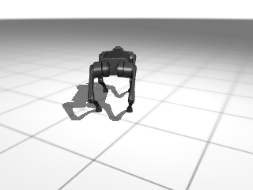
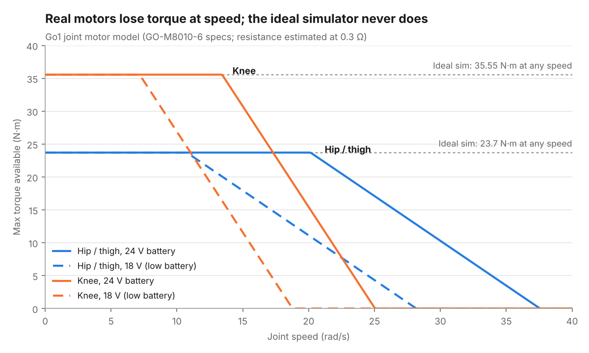

# Motor-Realistic RL

**Training legged robots for real motors, not ideal ones.**

<p align="center">
  
  <br>
  <em>Baseline: Go1 walking with a policy trained on ideal motors.</em>
</p>

Most simulated robot policies assume perfect motors: instant torque, no current limits, no delay. This project adds an electrical model of the motors to a simulated Unitree Go1 quadruped and asks two questions:

1. Which electrical effects break a policy trained with ideal motors, and by how much?
2. Does training with a realistic motor model bring the robustness back?

> **Status:** in progress (started November 2026). Baseline policy trained and measured; motor model built and unit-tested; plugging it into the simulator is next.

## How it works

```
Policy  ->  PD controller  ->  Motor model  ->  MuJoCo physics
  ^                                                   |
  +--------------  Sensor model  <--------------------+
```

The simulator stays standard. The work is in the two models between the policy and the physics.

**Motor model** (each effect has an on/off switch, so they can be tested one at a time):

- Control delay
- Voltage and current limits
- Back-EMF, winding resistance and inductance
- Battery sag under load
- Motor heating and torque derating

**Sensor model:** encoder quantization and sensor delay.

## The motor model

Built from the published specs of the Go1's joint motor (Unitree GO-M8010-6: 23.7 N·m peak, 0.639 N·m/A torque constant, 40 A peak current, 30 rad/s at 24 V; knees geared 1.5× to 35.55 N·m). Values Unitree doesn't publish (winding resistance, inductance, thermal constants) are explicit, documented estimates in [`motor_model/params.py`](motor_model/params.py).

<p align="center">
  
</p>

The "ideal" simulator already caps torque, but at **every** speed. A real motor's back-EMF eats into the battery voltage as it spins, so torque falls off above about 20 rad/s at the hip and thigh, and about 13 rad/s at the knee. A sagging battery makes it worse.

**Checking a key assumption:** the model treats motor current as instant within each 4 ms physics step. [`verify_current_model.py`](motor_model/verify_current_model.py) tests this against a 5 µs simulation of the winding and the driver's current loop: the torque error is 1.3% at the estimated inductance and stays under 5% across the whole plausible range (0.1–1 mH).

## Results so far

| Run | GPU | Training time | Final reward per episode |
| --- | --- | --- | --- |
| Baseline: Go1 joystick task, ideal motors, 200M environment steps | Colab T4 | 52 min (plus 3 min compile) | about 28.6 |

The reward rose quickly and leveled off well before 200M steps. This run is the reference that every motor-model experiment is compared against.

## Planned experiments

| # | Experiment | Result it produces |
| --- | --- | --- |
| 1 | Train with ideal motors, then test with each effect switched on | Effects ranked by how much they hurt performance |
| 2 | Retrain with the motor model on and its parameters randomized | How much robustness comes back |
| 3 | Sweep control delay, battery voltage and current limit | The point where the policy breaks |

**Metrics:** survival time, velocity-tracking error, peak motor current, and electrical energy per meter walked.

## Repo layout

| Path | What it is |
| --- | --- |
| `motor_model/` | The motor model (JAX), its parameters and the current-model check |
| `tests/` | Unit tests: one per physical behavior (torque-speed curve, battery sag, heating, ...) |
| `learning/notebooks/locomotion.ipynb` | Baseline Go1 training notebook (runs on Colab) |
| `learning/notebooks/evaluate_baseline.ipynb` | Measures a policy: falls, tracking error, torque |
| `scripts/` | Figure scripts |
| `results/` | Videos and figures from finished runs |

The environment wrapper and experiment scripts will be added as the project progresses.

## Running it

**Training (Google Colab, GPU):** [open the notebook in Colab](https://colab.research.google.com/github/nayans3/motor-realistic-rl/blob/main/learning/notebooks/locomotion.ipynb), set the runtime to GPU, and run the cells in order.

**Local development (motor model and tests):** Python 3.12, then from the repo root

```
pip install -r requirements.txt
python -m pytest
```

## Credits

- Simulation, robot models and the baseline notebook come from [MuJoCo Playground](https://github.com/google-deepmind/mujoco_playground) by Google DeepMind, under the Apache License 2.0. `learning/notebooks/locomotion.ipynb` is adapted from their notebook and keeps its original copyright notice.
- Built with help from an AI coding assistant (Claude). The design decisions, experiments and conclusions are my own.

## License

MIT (see `LICENSE`). Third-party code keeps its own license.

---

Nayan Saini · Electrical Engineering, University of Illinois Urbana-Champaign
